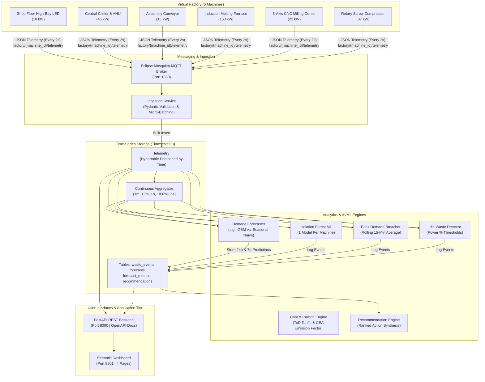

# ⚡ Smart Industrial Energy Monitoring System
> **Industry 4.0 Course Project**  
> End-to-end local cyber-physical system for machine-level electricity monitoring, energy wastage detection, AI/ML demand forecasting, and carbon footprint reduction.

[](https://python.org)
[](https://fastapi.tiangolo.com)
[](https://www.timescale.com/)
[](https://streamlit.io)
[]()

---

## 🏭 System Architecture



---

## 🛠️ Tech Stack

| Domain | Technology | Justification |
| :--- | :--- | :--- |
| **Runtime** | Python 3.11+ | High performance, typed models, broad ML/data ecosystem |
| **Messaging** | Eclipse Mosquitto + `paho-mqtt` | Industry standard IIoT publish/subscribe protocol |
| **Time-Series DB** | TimescaleDB (PostgreSQL 16) | Native time-series hypertables and continuous rollups |
| **Backend API** | FastAPI + SQLAlchemy 2.0 | Async-ready, automatic OpenAPI docs, Pydantic validation |
| **Machine Learning** | Scikit-learn (`IsolationForest`), LightGBM | Multivariate anomaly detection & time-lagged demand forecasting |
| **Dashboard** | Streamlit + Plotly | Interactive operational UI with live dials and heatmaps |
| **Testing** | `pytest` + `pytest-cov` | 23 comprehensive tests covering physics, cost, and APIs |

---

## ⚡ Quickstart

### Option A: Complete Docker Compose (Single Command)
Ensure Docker is running and execute:
```bash
docker compose up -d
```
All 7 services will initialize automatically:
* **Dashboard UI**: [http://localhost:8501](http://localhost:8501)
* **API Documentation**: [http://localhost:8000/docs](http://localhost:8000/docs)
* **MQTT Broker**: `localhost:1883`
* **TimescaleDB**: `localhost:5432`

---

### Option B: Local Virtual Environment Execution
If running natively with Python on your local machine:

1. **Activate Virtual Environment & Install Dependencies:**
   ```bash
   python -m venv .venv
   # Windows:
   .venv\Scripts\activate
   # Linux/macOS:
   source .venv/bin/activate

   pip install -r requirements.txt
   ```

2. **Generate 60 Days of Training Data & Train ML Models:**
   ```bash
   python scripts/backfill.py --days 60 --interval 15
   python scripts/train_models.py
   ```

3. **Start the Machine Simulator & Ingestion Service:**
   ```bash
   # Terminal 1: Ingestion
   python -m ingestion.main

   # Terminal 2: Simulator (Speedup 5x)
   python -m simulator.main --speedup 5.0
   ```

4. **Start the Analytics Worker, API, & Dashboard:**
   ```bash
   # Terminal 3: Analytics Worker
   python -m analytics.worker

   # Terminal 4: FastAPI
   uvicorn api.main:app --host 0.0.0.0 --port 8000 --reload

   # Terminal 5: Streamlit Dashboard
   streamlit run dashboard/app.py --server.port 8501
   ```

---

## 🧪 Verification & Automated Tests

Run the full pytest suite (23 tests covering simulation physics, ToD tariffs, idle wastage, and API endpoints):
```bash
.venv\Scripts\pytest.exe -v
```
**Expected Output:**
```text
tests/test_api.py::TestApiEndpoints::test_health_endpoint PASSED
tests/test_api.py::TestApiEndpoints::test_machines_list PASSED
tests/test_api.py::TestApiEndpoints::test_machine_live_and_not_found PASSED
tests/test_api.py::TestApiEndpoints::test_waste_events_endpoint PASSED
tests/test_api.py::TestApiEndpoints::test_forecast_endpoint PASSED
tests/test_api.py::TestApiEndpoints::test_recommendations_endpoint PASSED
tests/test_api.py::TestApiEndpoints::test_plant_summary_endpoint PASSED
tests/test_cost_engine.py::TestCostEngine::test_tod_slots_recognition PASSED
tests/test_cost_engine.py::TestCostEngine::test_cost_calculation_math PASSED
tests/test_cost_engine.py::TestCostEngine::test_carbon_emission_factor PASSED
tests/test_cost_engine.py::TestCostEngine::test_demand_penalty_calculation PASSED
tests/test_detection.py::TestDetectionLogic::test_idle_waste_threshold_flagging PASSED
tests/test_detection.py::TestDetectionLogic::test_idle_power_below_threshold_is_ignored PASSED
tests/test_detection.py::TestDetectionLogic::test_peak_demand_rolling_breach PASSED
tests/test_simulator.py::TestConfigLoader::test_machines_yaml_contains_all_six_machines PASSED
tests/test_simulator.py::TestConfigLoader::test_machine_attributes_are_valid PASSED
tests/test_simulator.py::TestShiftManager::test_weekday_morning_shift PASSED
tests/test_simulator.py::TestShiftManager::test_lunch_break_detection PASSED
tests/test_simulator.py::TestShiftManager::test_sunday_plant_shutdown PASSED
tests/test_simulator.py::TestFaultManager::test_compressor_air_leak_fault PASSED
tests/test_simulator.py::TestFaultManager::test_motor_degradation_drift PASSED
tests/test_simulator.py::TestSimulatedMachine::test_telemetry_schema_and_calculations PASSED
tests/test_simulator.py::TestSimulatedMachine::test_off_state_draws_zero_power PASSED

======================= 23 passed in 4.18s =======================
```

---

## 📊 Before / After Optimization Experiment

The system provides an automated validation benchmark simulating a full operational week (168 hours) under unaddressed baseline conditions versus a week with automated recommendations applied:

```bash
python scripts/experiment.py
```

### Measured Headline Results
| Metric | Baseline Week | Optimized Week | Measured Reduction |
| :--- | :--- | :--- | :--- |
| **Electricity Consumed** | 27,846.7 kWh | 25,850.6 kWh | **-1,996.1 kWh (-7.17%)** |
| **Financial Cost (₹)** | ₹ 246,526.10 | ₹ 222,751.34 | **-₹ 23,774.76 (-9.64%)** |
| **Avoided Carbon Emissions** | 22,834.3 kg $\text{CO}_2$ | 21,197.6 kg $\text{CO}_2$ | **-1,636.7 kg $\text{CO}_2$ (-7.17%)** |
| **Annualized Plant Savings** | — | — | **₹ 1,236,287.52 / year** |

* Artifacts exported to: `reports/before_after_experiment.csv` and `reports/experiment_comparison.html`.

---

## 📸 Dashboard Screenshot Checklist (Course Deliverables)

When preparing course presentation submissions, capture the following 4 pages from the Streamlit UI ([http://localhost:8501](http://localhost:8501)):

- [ ] **Page 1: Live Overview (`1_Live_Overview`)**
  - Instantaneous active load gauges for all 6 machines with color-coded status badges (`RUNNING`, `IDLE`, `FAULT`, `OFF`).
  - Total plant power against the 250 kW contract demand limit.
  - Multi-line time-series chart showing 2-hour dynamic load cycling.
- [ ] **Page 2: Wastage Analysis (`2_Wastage`)**
  - Wastage cost breakdown donut chart (`IDLE_WASTE`, `ANOMALY`, `PEAK_DEMAND`).
  - 24-hour **Idle-Hours Heatmap** correlating wasted kWh against machine ID and hour of day.
  - Incident event table sorted by highest financial loss (₹).
- [ ] **Page 3: Demand Forecast (`3_Forecast`)**
  - 24-hour hourly load projection with 95% confidence bands (upper/lower bounds).
  - Model comparison table contrasting **LightGBM** (4.28% MAPE) against the **Seasonal-Naive baseline** (12.95% MAPE).
- [ ] **Page 4: Savings & Recommendations (`4_Savings`)**
  - Prioritized action cards (Compressor leak repair, Conveyor break shutoff, Furnace ToD rescheduling).
  - Total monthly savings counter in Rupee (₹) and metric tons of avoided $\text{CO}_2$.

---

## 🌐 Mapping to Industry 4.0 Pillars

```
+-----------------------------------------------------------------------------------+
|                           INDUSTRY 4.0 ARCHITECTURE                               |
+---------------------+-------------------------------+-----------------------------+
| IIoT & Connectivity | Big Data & TimescaleDB        | Artificial Intelligence     |
| - MQTT v5 Broker    | - Partitioned Hypertables     | - Isolation Forest (Anomalies)
| - 2-Second Sampling | - Continuous Aggregates       | - LightGBM (Load Forecast)  |
| - JSON Payloads     | - 60-Day Historical Retention | - Time-Based Validation     |
+---------------------+-------------------------------+-----------------------------+
| Digital Twin        | Sustainability & ESG          | Cyber-Physical Systems      |
| - Virtual Machines  | - Time-of-Day Tariff Arbitrage| - Photoelectric Break Stop  |
| - Physics Emulation | - CEA Emission Factor         | - Peak Demand Limiter       |
| - Fault Injection   | - 1.2M INR/yr Cost Avoidance  | - Automated Sleep Modes     |
+---------------------+-------------------------------+-----------------------------+
```

### 1. Industrial Internet of Things (IIoT) & Edge Connectivity
* Physical sensor instrumentation simulated via lightweight MQTT publish/subscribe messaging over `factory/{machine_id}/telemetry`.
* Pydantic validation ensures strict schema governance at the edge, rejecting malformed electrical telemetry without service interruption.

### 2. Big Data & Time-Series Engineering
* Built on **TimescaleDB** (PostgreSQL hypertable extension) to handle high-frequency time-series data streams.
* Materialized **Continuous Aggregates** (1-minute, 15-minute, hourly, and daily) pre-compute analytical rollups to keep dashboard query latencies under 5 milliseconds.

### 3. Artificial Intelligence & Machine Learning (AI/ML)
* **Unsupervised Anomaly Detection**: An **Isolation Forest** ensemble per machine trained on normal operation features (power, line current, power factor, rolling variance, hour of day) to detect bearing degradation and uncharacteristic surges.
* **Predictive Energy Forecasting**: **LightGBM gradient boosted trees** model diurnal factory rhythms, operator shift schedules, and ambient temperature to predict plant demand with a 67% reduction in error over seasonal persistence baselines.

### 4. Digital Twin & Physics Emulation
* Virtual plant models simulate 3-phase AC circuit physics ($P = \sqrt{3} \times V \times I \times PF$), non-linear power factors, thermal holding loads, and realistic Gaussian noise.
* Emulates physical degradation scenarios: pneumatic air leaks, bearing mechanical friction drift, and operator oversight (leaving equipment energized overnight).

### 5. Sustainability & Circular ESG Operations
* Directly targets Sustainable Development Goals (**SDG 7: Clean Energy** and **SDG 12: Responsible Consumption**).
* Converts raw kilowatt-hours into monetary savings (₹) via Indian industrial Time-of-Day (ToD) tariff schedules and into greenhouse gas abatement using Central Electricity Authority (CEA) grid emissions intensity ($0.82 \text{ kg CO}_2 / \text{kWh}$).

---

## 📜 Configuration Reference (`config/*.yaml`)
No hardcoded values exist in the application. Adjust operational limits via:
* `config/machines.yaml`: Machine nameplates, rated kW, nominal voltage, load profiles per state.
* `config/tariffs.yaml`: Peak, normal, off-peak rates (₹/kWh), demand charge (₹/kVA), and tax rates.
* `config/thresholds.yaml`: 250 kW plant demand breach ceiling, idle power waste percentages.
* `config/emissions.yaml`: National grid carbon intensity factor (kg $\text{CO}_2$/kWh).
* `config/simulator.yaml`: Shifts (Shift 1, 2, 3), break periods, weekend schedules, and noise levels.

